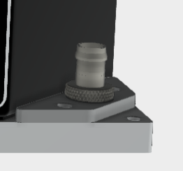

# Mechanical Specifications

## Dimentions

{{ figure('../assets/ADB-PC-AC01_3D.png', 'ADB-PC-AC01 3D model') }}

| **Parameter** | **Value** | **Unit** |
|---------------|-----------|----------|
| **Dimensions (L × W × H)** | 725 × 440 × 176 | mm |
| **Dimensions with connectors** | 750 × 440 × 176 | mm |
| **Weight** | 43 | kg |
| **Mounting** | 4U rack or custom brackets | - |
| **Cooling** | Liquid cooled | - |
| **Ingress Protection** | IP67 | - |

## Liquid Cooling

The ADB-PC-XXXX are watercooled power converters.

Each unit has 4 ports - two for top plate, two for bottom plate. To simplify the integration, the units come with the left-side top+bottom ports interconnected from the factory.

The recommended flow of water would look like this. Color indicates the temperature rise, arrows indicate flow direction

{{ figure('../assets/ADB-PC-XXXX_liquid_flow.png', 'Liquid flow') }}

### Heat dissipation

Thermal dissipation of each unit depends on operational conditions - voltage, current, power level. Typical heat load can be calculated by multiplying the processed power by the losses (1 - efficiency) at that operation point.

A typical loss at full load would be: 50 kW * (1 - 0.97) = 1.5 kW
For the efficiency at a specific operating point, please consult the [Efficiency Characteristics](electrical_specs.md#efficiency-characteristics).
1.5 kW of heat generation per converter would result in approximately 5 &deg;C temperature rise (inlet to outlet, 5 l/min).

The converter has high thermal inertia owing to the large aluminium plates and the coolant loop. That means it can take a long time (>10 minutes in some cases) for the temperature to noticably change.
It is important that the coolant is kept flowing through the power converters during opreration.

!!! tip
    It is ok to run power converters on a test bench without a cooling system attached. In this case the converter needs to be actively
    monitored. It is not recommended to operate the converters at high power in this scenarios.

### Flow and temperature rise

The recommended cooling medium is a water-glycol mix. The ratio depends on the environmental conditions (freeze prevention).
The Glycol lowers the freezing temperature and acts as a corrosion inhibiting agent in case of mixed-metal cooling loops. Additional additives could include organic growth inhibitors.

!!! warning
    It is important to use the correct coolant formulation. The heatsinks are made out of aluminium, distribution manifolds tends to be made out of stainless steel, 
    fittings tends to be made out of nickel-plated brass, pipes in the heat exchangers tends to be made ouf of copper.
    To limit the galvanic corrosion and organic growth in the coolant loop, use only glycol-based coolant fluids formulated for mixed metal loops containing aluminium, with organic growth inhibitors.
    Do not use tap water or distilled water in the loop. Consult a coolant manufacturer before commissioning.
    Failure to follow this can result in clogged pumps, limited cooling performance, and in the worst case, damaged fittings and leaks.

Required flow rate is 5 liters per minute (5 l/min). The flow can be increased, to extend full power operation region in hot climates. Do not exceed 15 l/min.

Since the units are designed to be used in a parallel loop (cold water pushing into all the boxes at the same time through a manifold), there has to be enough water pressure to spread equally between all converters. If the flow is not restrictive enough per heatsink (or water inlets), there is a risk there won’t be enough pressure to feed all units equally (especially considering the vertical stacking in a rack).
One way to test how well the fluid is distributed is to (temporarily) install flow indicators on every high pressure port on the first rack you build.

### Port adapter

Each port (inlet and outlet) uses G1/4" thread (British Standard Pipe). Unless specified separately by the customer, each unit comes with barbed fittings installed on all ports.
The barbed fittings are compatible with 3/8" (10 mm) internal diameter hoses.

<!--  -->

{{ figure('../assets/barbed_fitting.png', 'Barbed fitting') }}

The converters are shipped with a pre installed hose on the left hand side connecting both cooling plates.

### No-drip alternatives

There are a number of no-drip fittings that can be installed instead of the straight barbed fitting.
However, given that the hose connects to the manifold (distributor), it makes more sense to place the no-drip fittings there (so the disconnection happens on the manifold side, not on the converter side).
